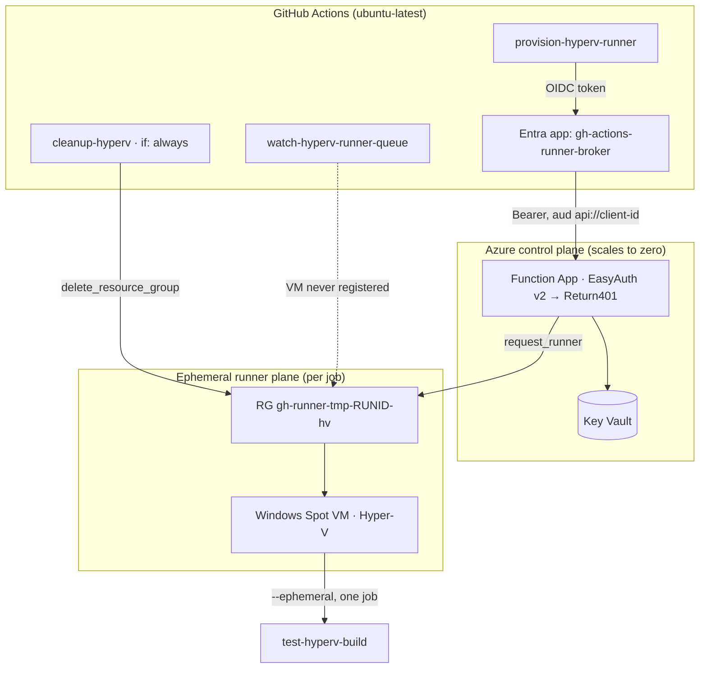

# Design: On-demand Hyper-V GitHub Actions runners on Azure

Sailwright's Windows CI has to run a hypervisor: it builds and smoke-tests a real
Windows 11 VM with Packer and Vagrant, which requires **nested virtualization**.
GitHub-hosted runners don't provide that, so this repo ships its own runner platform —
a serverless broker that provisions a **Hyper-V-capable Windows Spot VM per job** on
Azure and deletes it afterwards. Authentication is GitHub OIDC end-to-end; there are no
long-lived cloud secrets.

This document explains how it works and why. For a narrative walkthrough see the
companion blog post; this doc is the reference for maintainers.

## Why nested virtualization is required

The two tests that gate a Windows release boot a nested guest:

- [`TestBuildHypervWindows11Amd64OnWindows`](../../pkg/build/windows-build_test.go#L12)
  — a full Packer Hyper-V build of Windows 11.
- [`TestRunHypervVagrantDeployOnWindows_Smoke`](../../pkg/deploy/windows-hyperv-deploy_test.go#L72)
  — deploys the produced `.box` with Vagrant on Hyper-V.

The nested Packer template boots a real ISO on Hyper-V's internal switch as a
Generation-2 VM with Secure Boot and vTPM
([windows11-on-windows-hyperv.pkr.hcl:58](../../build/packer/windows/windows11-on-windows-hyperv.pkr.hcl#L58)).
This needs a VM SKU with nested-virtualization support — the `Dds_v5` family; the
runner uses `Standard_D4ds_v5`
([manager.tf:91](../../deployments/terraform/modules/azure_gh_runner/manager.tf#L91)).

## Architecture

Three planes: an always-on but effectively-free control plane, the broker logic, and a
per-job ephemeral runner plane.

*(Source diagram: [scripts/gh-runner-func/README.md:24](../../scripts/gh-runner-func/README.md#L24).)*

**Control plane** — provisioned once with Terraform: a Python Function App on the `Y1`
Consumption plan, plus Key Vault, storage, App Insights.
[manager.tf](../../deployments/terraform/modules/azure_gh_runner/manager.tf).

**Broker** — two HTTP routes:
[`request_runner`](../../scripts/gh-runner-func/function_app.py#L154) mints a
registration token and creates the VM;
[`delete_resource_group`](../../scripts/gh-runner-func/function_app.py#L117) tears it
down. For each request the broker imperatively creates a dedicated RG, VNet, NSG, NIC,
public IP, and the Spot VM via the Azure SDK
([function_app.py:249](../../scripts/gh-runner-func/function_app.py#L249)+).

**Ephemeral runner plane** — one throwaway VM per job, targeted by label
([test-build-windows.yml:121](../../.github/workflows/test-build-windows.yml#L121)).

### Lifecycle of one run

`provision-hyperv-runner` ([:37](../../.github/workflows/test-build-windows.yml#L37)) →
VM self-bootstraps → `test-hyperv-build`
([:109](../../.github/workflows/test-build-windows.yml#L109)) →
`watch-hyperv-runner-queue`
([:216](../../.github/workflows/test-build-windows.yml#L216)) → `cleanup-hyperv`
(`if: always()`, [:422](../../.github/workflows/test-build-windows.yml#L422)).

The trigger is a workflow-driven `az rest` POST
([test-build-windows.yml:58](../../.github/workflows/test-build-windows.yml#L58)), **not**
a GitHub `workflow_job` webhook — this keeps the broker to two authenticated endpoints
with no public webhook surface.

## Enabling Hyper-V on the runner

The broker injects [runner-setup.ps1](../../scripts/gh-runner-func/runner-setup.ps1) as
base64 `custom_data`. Sequence:

1. Install the Hyper-V role (Server vs. client editions differ) —
   [:94](../../scripts/gh-runner-func/runner-setup.ps1#L94).
2. Survive the reboot: register a `ContinueRunnerSetup` startup task, reboot, resume —
   [:160](../../scripts/gh-runner-func/runner-setup.ps1#L160).
3. Create an internal NAT switch for nested guests (`Default Switch`) —
   [:184](../../scripts/gh-runner-func/runner-setup.ps1#L184).
4. Scope a DHCP server to that switch, bound to the switch adapter (not the Azure NIC) —
   [:218](../../scripts/gh-runner-func/runner-setup.ps1#L218).
5. Grant the runner account Hyper-V rights and register `--ephemeral` —
   [:285](../../scripts/gh-runner-func/runner-setup.ps1#L285).

Steps 2–4 are the non-obvious ones; an earlier bootstrap
([scripts/gh_actions/cloud-init.ps1](../../scripts/gh_actions/cloud-init.ps1)) only did
step 1 and was not reliable for CI. The runner agent and toolchain are baked into a
Packer golden image
([windows-azure-gh-runner.pkr.hcl](../../build/gh_actions/windows-azure-gh-runner.pkr.hcl))
so first boot is mostly "enable Hyper-V + register," keeping paid runtime short.

## Security model

- **GitHub OIDC federation to Entra, no stored secrets.** Two federated credentials
  scope access to `main` and PRs of this repo
  ([github_oidc.tf:46](../../deployments/terraform/modules/azure_gh_runner/github_oidc.tf#L46)).
  The workflow uses `id-token: write` and `azure/login@v3` with IDs only
  ([test-build-windows.yml:3](../../.github/workflows/test-build-windows.yml#L3),
  [:45](../../.github/workflows/test-build-windows.yml#L45)).
- **Defense in depth at the broker.** Platform EasyAuth v2 rejects anonymous callers
  ([manager.tf:109](../../deployments/terraform/modules/azure_gh_runner/manager.tf#L109)),
  and the code re-validates `tid`/`aud`/`azp`/`oid` against allowlists
  ([function_app.py:63](../../scripts/gh-runner-func/function_app.py#L63)).
- **Managed identity, not app secrets** —
  [manager.tf:101](../../deployments/terraform/modules/azure_gh_runner/manager.tf#L101).
- **Short-lived registration tokens.** The PAT stays in Key Vault; the broker exchanges
  it for a throwaway runner token handed to the VM via cloud-init, never persisted
  ([function_app.py:186](../../scripts/gh-runner-func/function_app.py#L186)).
- **Ephemeral isolation + blast-radius guard.** Own RG per job, `--ephemeral` runner,
  full teardown; deletion requires both the `gh-runner-tmp` name prefix and the
  broker's `managed-by=gh-runner-broker` ownership tag
  ([function_app.py:398](../../scripts/gh-runner-func/function_app.py#L398)). The broker
  identity runs on a least-privilege custom role, not subscription-wide `Contributor`
  ([manager.tf:142](../../deployments/terraform/modules/azure_gh_runner/manager.tf#L142)).
- **Input validation.** Repo regex + flavor allowlist
  ([function_app.py:19](../../scripts/gh-runner-func/function_app.py#L19)).
- **Supply chain.** Cosign keyless signing of release checksums
  ([release-binaries.yml:101](../../.github/workflows/release-binaries.yml#L101)),
  `gitleaks`/`govulncheck`/`gosec`
  ([security-scan.yml](../../.github/workflows/security-scan.yml)), build-log redaction
  ([pkg/build/log_sanitizer.go](../../pkg/build/log_sanitizer.go)).

## Cost model

Near-zero idle baseline; compute is deleted (not stopped) between jobs.

- **Consumption plan scales to zero** — `Y1`
  ([manager.tf:124](../../deployments/terraform/modules/azure_gh_runner/manager.tf#L124)).
- **No standing VM** — whole RG deleted in `if: always()` cleanup, so no disk/IP cost
  between runs.
- **Spot VMs with on-demand fallback** —
  [function_app.py:356](../../scripts/gh-runner-func/function_app.py#L356); default
  `VM_USE_SPOT = "true"`
  ([manager.tf:92](../../deployments/terraform/modules/azure_gh_runner/manager.tf#L92)).
- **Watchdog** kills a VM that never registers
  ([test-build-windows.yml:216](../../.github/workflows/test-build-windows.yml#L216)).
- **Cheap orchestration** on free `ubuntu-latest`; only the build runs on the paid VM.
- **LRS storage**, standard Key Vault
  ([manager.tf:47](../../deployments/terraform/modules/azure_gh_runner/manager.tf#L47),
  [cache.tf:12](../../deployments/terraform/modules/azure_gh_runner/cache.tf#L12)).

## Known trade-offs

Deliberate simplicity/cost trade-offs, tracked with a triage and fix plan in
[plans/PLAN Runner Security Hardening 2026-07-26.md](../../plans/PLAN%20Runner%20Security%20Hardening%202026-07-26.md).

**Open:**

| Trade-off | Where |
| --- | --- |
| `winrm_insecure = true` during image build (transient Packer VM only) | [windows-azure-gh-runner.pkr.hcl:89](../../build/gh_actions/windows-azure-gh-runner.pkr.hcl#L89) |

**Resolved (2026-07-26 hardening pass):**

| Was | Now |
| --- | --- |
| NSG opened RDP 3389 to `*` on a public IP | Inbound RDP rule removed; NSG adds no inbound rules (runner is outbound-only) |
| Function identity held subscription-wide `Contributor` | Least-privilege custom role `gh-runner-broker` (RG create/delete + `Microsoft.Compute/*` + `Microsoft.Network/*`, no data-plane/IAM) |
| Key Vault `purge_protection_enabled = false` | `purge_protection_enabled = true` |
| RG-delete safety rested on the name-prefix guard alone | Prefix guard **plus** required `managed-by=gh-runner-broker` ownership tag |

## Key files

- Broker: [scripts/gh-runner-func/](../../scripts/gh-runner-func/)
- IaC: [deployments/terraform/modules/azure_gh_runner/](../../deployments/terraform/modules/azure_gh_runner/)
- Orchestration: [.github/workflows/test-build-windows.yml](../../.github/workflows/test-build-windows.yml)
- Golden image: [build/gh_actions/windows-azure-gh-runner.pkr.hcl](../../build/gh_actions/windows-azure-gh-runner.pkr.hcl)
